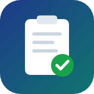
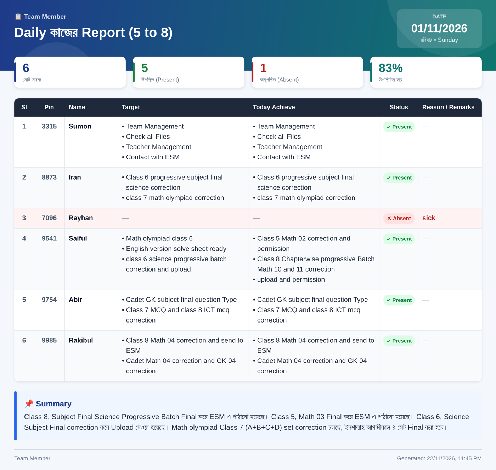
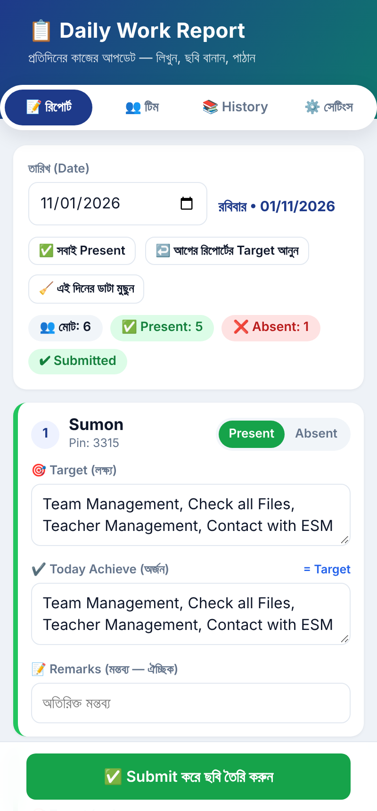
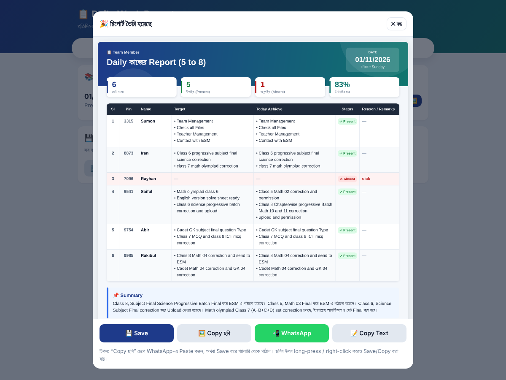

<div align="center">



# Daily Work Report Generator

**Turn a team's daily work log into a clean, shareable report image, in under a minute.**

প্রতিদিনের কাজের আপডেট লিখুন, এক ক্লিকে সুন্দর ছবি বানান, আর WhatsApp-এ বসকে পাঠিয়ে দিন।


### [🚀 Live Demo](https://tariqulislam4015.github.io/daily-work-report/)



</div>

---

## 💡 The problem

Team leads often send their manager a daily status update on WhatsApp. Typing it by hand every evening is slow, the format changes from day to day, and long text messages are hard to read on a phone.

## ✅ The solution

A small web app where you fill in each member's **target**, **achievement** and **attendance**. One tap turns it into a polished **report image** (with summary cards, a color-coded table and the day's summary), ready to **save**, **copy** or **share on WhatsApp**.

## ✨ Features

| | Feature | Details |
|---|---|---|
| 👥 | **Team roster** | Add, rename, reorder or remove members, each with a PIN |
| 📝 | **Daily entry** | Target, Today Achieve, Present / Absent, Reason, Remarks and a day Summary |
| 🖼️ | **Report image** | High-resolution PNG drawn on `<canvas>`, with Bengali + English text, auto-wrapping cells and bullet lists |
| 📲 | **One-tap sharing** | Native share sheet (WhatsApp) on phones, Copy image, Save PNG, or WhatsApp-formatted text |
| 📊 | **Live stats** | Total / Present / Absent / attendance rate |
| ⚡ | **Shortcuts** | "= Target" fills achievement, "All Present", and copy targets from the previous report |
| 📚 | **History** | Every day is saved; reopen or re-export any past report |
| 💾 | **Backup** | Export / import all data as JSON to move between devices |
| 📱 | **Installable PWA** | Add to home screen, works offline |
| 🔒 | **Private by design** | No server, no login: data stays in the browser's `localStorage` |

## 📸 Screenshots

<table>
<tr>
<td width="32%"></td>
<td></td>
</tr>
<tr>
<td align="center"><b>Mobile entry form</b></td>
<td align="center"><b>Generated report and share options</b></td>
</tr>
</table>

## 🛠️ How it works

```
Form input ──► localStorage (auto-save, per date)
     │
     ▼
Submit ──► validate (absent ⇒ reason required)
     │
     ├──► Canvas renderer ──► PNG blob ──► Save / Copy / Web Share (WhatsApp)
     └──► Text builder ─────► WhatsApp-formatted message (*bold*, emoji)
```

**Technical highlights**

- **Custom canvas layout engine.** Measures and wraps text per column, splits comma-separated tasks into bullets with hanging indents, and sizes each row to its tallest cell. Rendered at 2× for sharp text on phones.
- **Correct Bengali rendering.** Breaks long words on grapheme clusters (`Intl.Segmenter`) so conjunct characters never split, and waits for the font to load before drawing.
- **Progressive sharing.** Tries the Web Share API with the image file first, then the Clipboard API (`ClipboardItem`), then falls back to a `wa.me` text link.
- **Zero build step, zero dependencies.** One HTML file plus a service worker. Open it and it runs.

## 🚀 Getting started

**Use it online:** open the [Live Demo](https://tariqulislam4015.github.io/daily-work-report/). On a phone, choose *Add to Home screen* to use it like an app.

**Run locally:**

```bash
git clone https://github.com/tariqulislam4015/daily-work-report.git
cd daily-work-report
# open index.html in a browser, or serve it:
python3 -m http.server 8000   # then visit http://localhost:8000
```

**Daily workflow:**

1. Set up your team once in **👥 টিম**, and your name/title in **⚙️ সেটিংস**.
2. Each evening, fill in the **📝 রিপোর্ট** tab (it opens on today's date).
3. Tap **✅ Submit** → **📲 WhatsApp** → choose your boss's chat.

## 📁 Project structure

```
daily-work-report/
├── index.html            # the whole app: UI, state, canvas renderer
├── sw.js                 # service worker for offline use
├── manifest.webmanifest  # PWA metadata
├── icons/                # app icons (SVG + PNG)
└── screenshots/
```

## 🗺️ Roadmap

- [ ] Cloud sync so the same data is available on every device
- [ ] Weekly and monthly attendance summary
- [ ] Custom logo and color theme in the report image
- [ ] PDF export

## 📄 License

[MIT](LICENSE). Free to use and adapt.
